# FXjutsu

**Higgsfield-style VFX presets on your own footage, fully open weights.**
Upload a clip, pick an effect, get the effect rendered onto the real shot with its original sound.

Built for Comfy's [Open Source Higgsfield](https://comfy.org/open-source-higgsfield) challenge on the
[Comfy Developer Platform](https://comfy.org/platform/) (Comfy API + Comfy SDK).
Core video model: [LTX-2.5](https://huggingface.co/Lightricks/LTX-2.5) (22B, video + audio, open weights) plus Lightricks'
IC-LoRA adapters. No partner API nodes anywhere in the pipeline.

| Preset | What it does | Adapter |
|---|---|---|
| Vanish | Removes every person, creature and vehicle, keeps the location and camera move | Clean-Plate |
| Day to Night | Relights the same shot as a moonlit night | Day-To-Night |
| Flood / Tsunami | Adds water that reacts to the scene, from a shallow flood to a tsunami | Water-Simulation |
| Alpha Matte | Pulls a clean alpha matte of the foreground, no green screen | Alpha-Gen |
| Set on Fire / Smoke | Paint where the fire or smoke goes, get a simulation that grows between your keyframes | AInVFX Fluid |
| Claymation / Frozen / Anime | Re-render the shot in a new look while keeping its structure and motion | Union Control (depth) |
| **Golden Statue / Hologram** | Only the people change; the rest of the frame stays the original footage, pixel for pixel | Alpha-Gen + Union Control, composited |
| **Toon World** | The world turns into an anime, the people in it stay real | Alpha-Gen + Clean-Plate + Union Control, composited |
| **Ghost** | The people turn into see-through, glowing ghosts over the rebuilt background | Alpha-Gen + Clean-Plate, composited |

**Demo video (1:51):** [docs/demo/fxjutsu_demo.mp4](docs/demo/fxjutsu_demo.mp4)

## Examples (before on top, after below)

| Vanish, real street footage | Day to Night, real park footage |
|---|---|
| 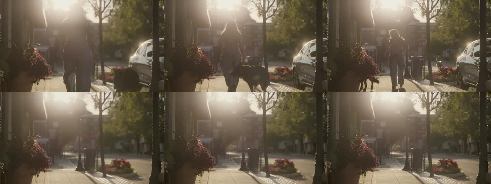 | 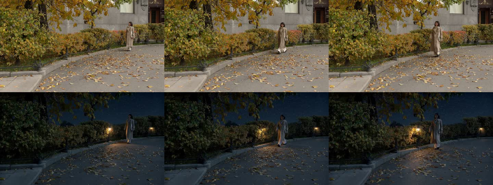 |

| Anime, real park footage (depth-guided restyle) | Set on Fire, real street footage (top: the two painted keyframes) |
|---|---|
| 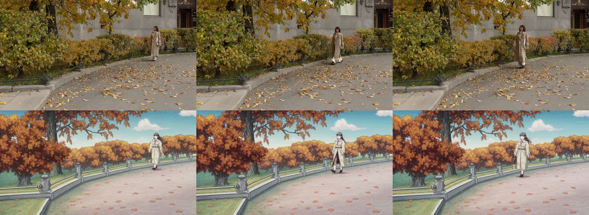 | 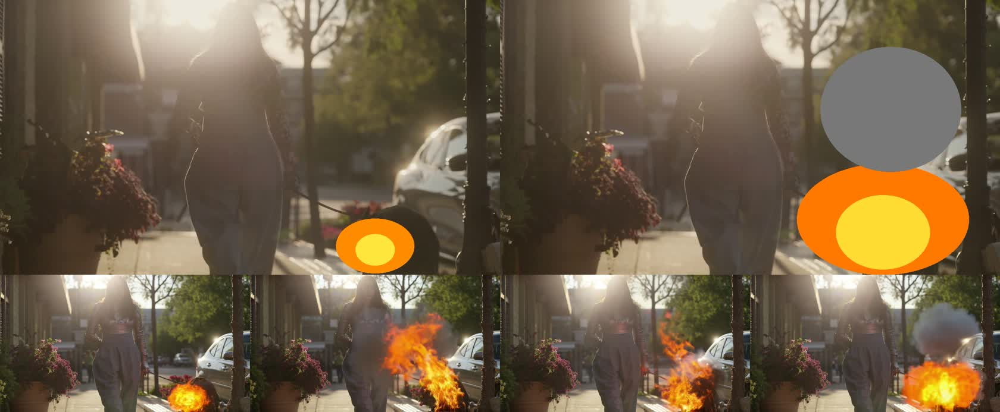 |

| Flood (strength 1.3) and Rainy Day (1.1) on the same street clip | Claymation |
|---|---|
| 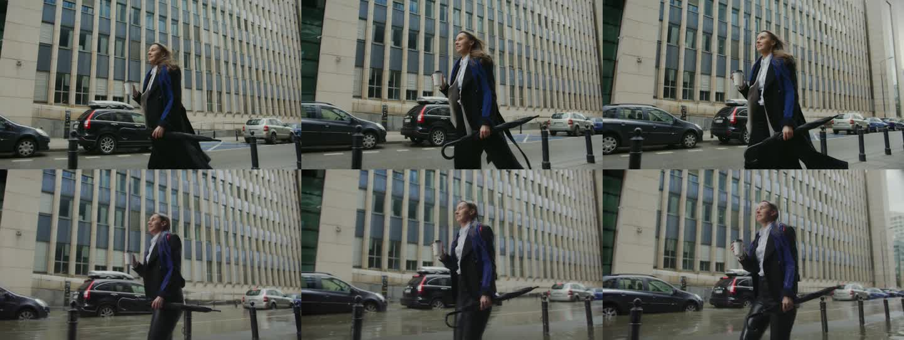 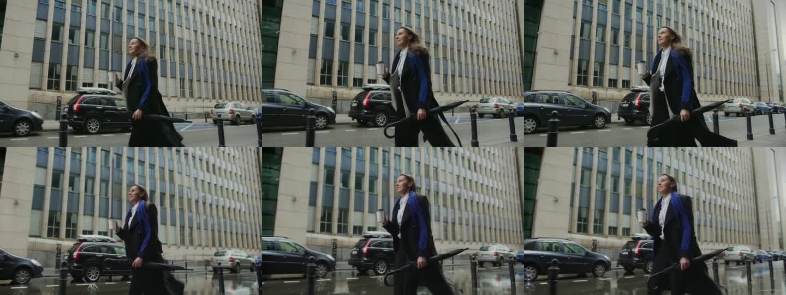 | 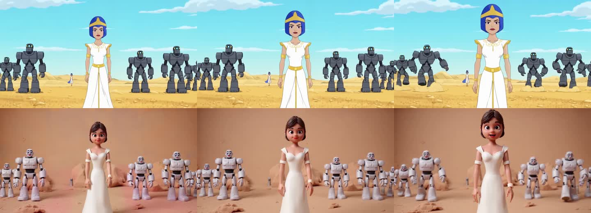 |

Water simulation (middle row) and alpha matte (bottom row) on the same clip: 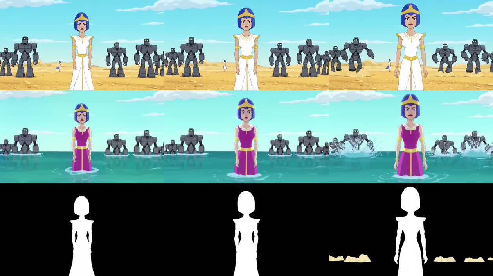

All renders: RTX 4090, LTX-2.5 distilled int8, 8 steps, native resolution, 2-3 minutes per 5-second clip.

## Composite effects: three adapters, one graph

A single IC-LoRA pass re-generates the whole frame at about 544p. The composite presets chain adapters inside one ComfyUI
graph and finish with a real compositing step, the way a VFX artist would:

```
clip ──┬── Alpha-Gen IC-LoRA ─────────────────────────────▶ matte: who is the subject
       ├── Clean-Plate IC-LoRA ──▶ the same shot, empty ──┐   (Toon World, Ghost)
       └── Union Control restyle (depth) ◀────────────────┘   (Golden Statue, Hologram, Toon World)
                                   │
         core-node composite at the clip's own resolution (ImageCompositeMasked, GrowMask, ImageBlur, MaskComposite)
                                   ▼
       outside the matte (or inside it, for Toon World) every pixel is the original footage, with the original sound
```

- **Golden Statue / Hologram:** restyle the shot by depth, then keep only the subject (Alpha-Gen matte, grown 2 px and
  feathered) over the untouched original frames.
- **Toon World:** remove the people first (Clean-Plate), restyle the *empty* plate, then lay the real people back on top.
  Restyling the empty plate is what keeps a cartoon copy of the subject from peeking out around the real one.
- **Ghost:** the clean plate fills the hole, and the subject goes back on top at 62% with a screen-blended glow and a
  cold tint.

The graphs are generated, not hand-wired: [`scripts/build_composite_workflows.py`](scripts/build_composite_workflows.py)
copies the two tested Lightricks graphs as prefixed passes (`matte.*`, `plate.*`, `fx.*`), de-duplicates the shared model
loaders, and joins them with core nodes only, so the same Comfy API build serves them. Details that make the composite
line up: the clip is trimmed to 5 s with `Video Slice` *before* decoding and capped at 121 frames and 1920 px; the restyle
pass stretches its depth guide to a multiple of 64 instead of centre-cropping it, so the matte and the restyle cover the
same pixels; LTX renders 8k+1 frames, so the original frames, the matte and the sound are trimmed to the rendered count.

On an RTX PRO 6000 (the hosted GPU) a composite takes about 45-60 s (two passes) or 100 s (Toon World, three passes)
once the models are loaded.

Golden Statue, step by step (source, Alpha-Gen matte, full-frame restyle, composite):
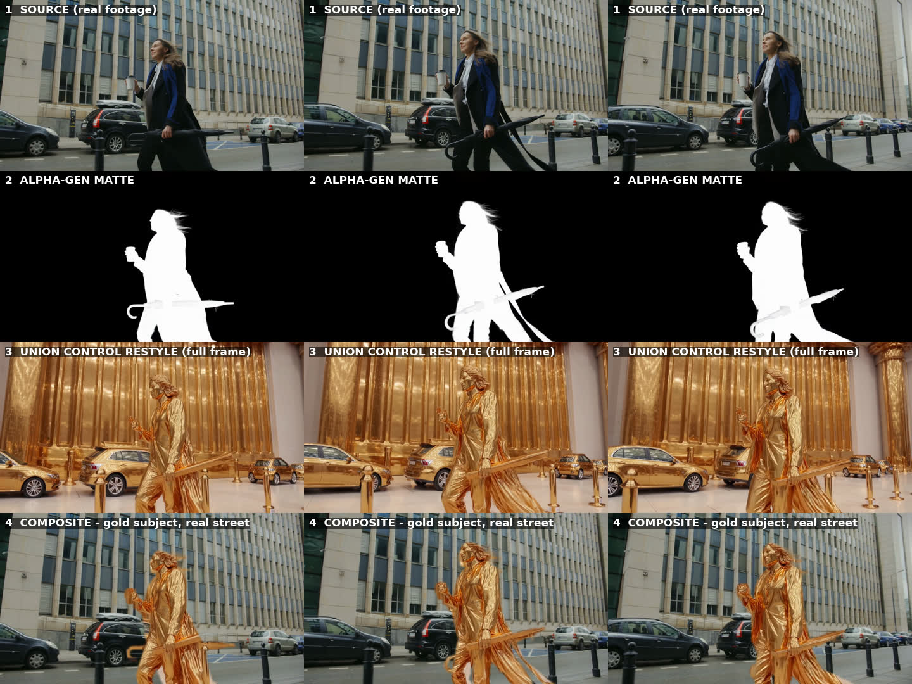

Toon World, step by step (source, Clean-Plate pass, restyle of the empty plate, composite):
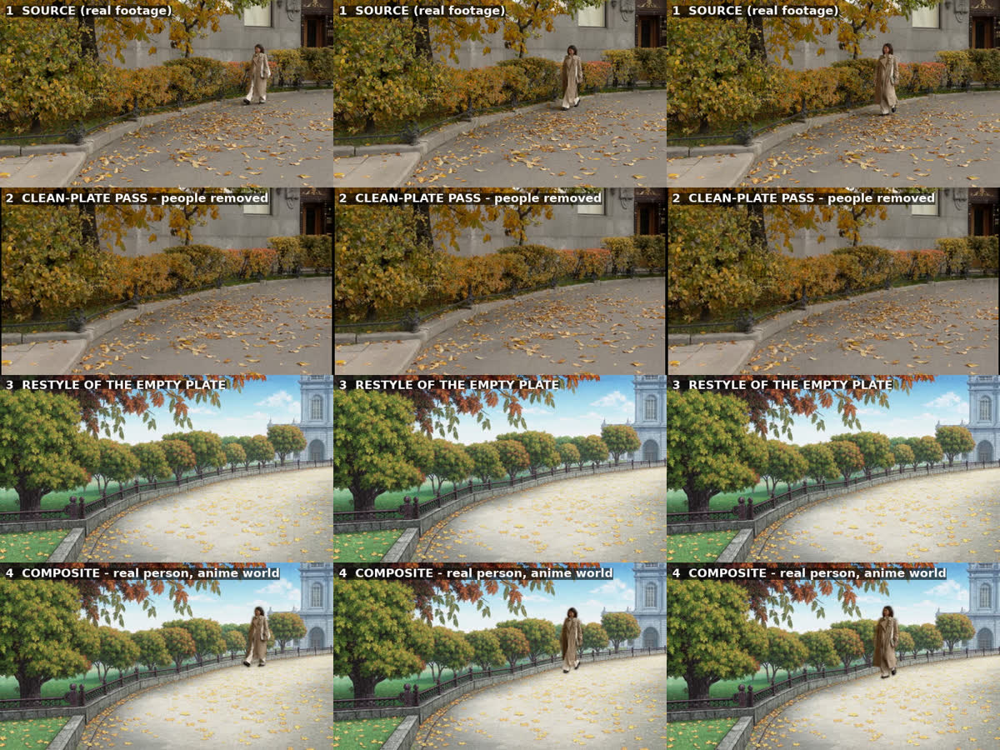

| Hologram | Ghost |
|---|---|
| 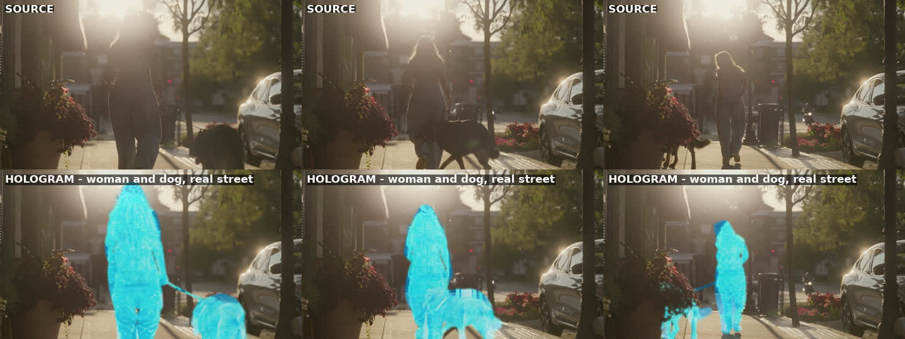 | 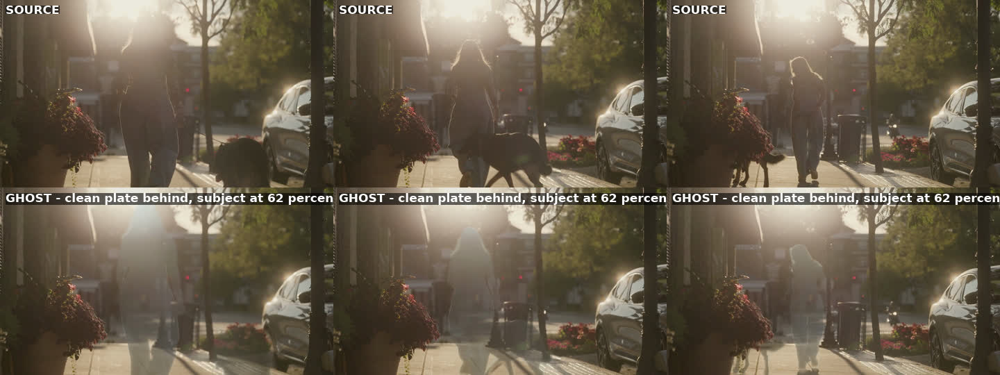 |

## How it works

```
browser  ──upload clip + first frame, preset, notes──▶  Next.js API route (app/api/jobs)
                                                          │  @comfyorg/sdk: assets + workflow inputs
                                                          ▼
                                     Comfy API deployment  (or local ComfyUI via comfy-api-proxy)
                                                          │  workflows/ltx25_v2v.api.json
                                                          ▼
                                 LTX-2.5 distilled int8 + IC-LoRA adapter, 8 steps, native resolution
                                                          │
                                                          ▼
                               result video (with the source audio) ◀── polled + streamed back to the UI
```

Three Lightricks LTX-2.5 graphs exported in API format (video-to-video IC-LoRA, Union Control restyle, AInVFX fluid)
plus the three generated composite graphs serve every preset; the app only swaps the adapter, strength, prompt and inputs
by node id (`lib/comfy.ts`). Prompt conventions per adapter are documented in [`docs/adapters.md`](docs/adapters.md).

## Run it locally (24 GB GPU)

Tested on an RTX 4090: one 5-second clip renders in about 2-3 minutes.

1. ComfyUI 0.41+ with these custom nodes: [ComfyUI-LTXVideo](https://github.com/Lightricks/ComfyUI-LTXVideo) and
   [ComfyUI-Video-Depth-Anything](https://github.com/yuvraj108c/ComfyUI-Video-Depth-Anything) (restyle and composite looks).
2. Models (accept the LTX-2.x Community License on Hugging Face first; sizes are approximate):

   | Folder | File | Size |
   |---|---|---|
   | `diffusion_models/` | `ltx-2.5-22b-distilled-transformer-comfy-int8-convrot.safetensors` | 21.5 GB |
   | `text_encoders/` | `gemma4-12b-with-proj-ltx-2.5-comfy-int8-convrot.safetensors` | 15.4 GB |
   | `text_encoders/` | `gemma4_e2b_it_int8_convrot.safetensors` (prompt enhancer, from Comfy-Org/gemma-4) | 5.2 GB |
   | `vae/` | `ltx-2.5-video-vae-bf16.safetensors`, `ltx-2.5-audio-vae-bf16.safetensors` | 1.5 GB + 0.4 GB |
   | `loras/` | `ltx-2.5-22b-ic-lora-clean-plate-1.0.safetensors` | 0.3 GB |
   | `loras/` | `ltx-2.5-22b-ic-lora-day-to-night-0.9.safetensors` | 0.3 GB |
   | `loras/` | `ltx-2.5-22b-ic-lora-water-simulation-0.9.safetensors` | 0.9 GB |
   | `loras/` | `ltx-2.5-22b-ic-lora-alpha-gen-0.9.safetensors` | 1.3 GB |
   | `loras/` | `ainvfx-fluid.safetensors` (from AInVFX/ainvfx-fluid, `ltx-2.5/`) | 0.65 GB |
   | `loras/` | `ltx-2.3-22b-ic-lora-union-control-ref0.5.safetensors` | 0.65 GB |

   All from `https://huggingface.co/Lightricks/<repo>` unless noted. `scripts/download-models.sh` fetches them with the `hf` CLI.
3. Start ComfyUI (`python main.py --listen 0.0.0.0 --port 8188`).
4. Bridge it to the Comfy API contract: `pip install comfy-api-proxy && comfy-api-proxy run --comfyui http://127.0.0.1:8188 --port 8189`
5. App:
   ```bash
   git clone https://github.com/audriu/fxjutsu && cd fxjutsu
   cp .env.example .env.local        # COMFY_BASE_URL=http://127.0.0.1:8189, COMFY_API_KEY=local
   npm ci && npm run dev             # http://localhost:3000
   ```

## Run it on the Comfy Developer Platform

The same `workflows/ltx25_v2v.api.json` deploys as a Comfy API endpoint (`comfy build init` with the models above as blobs,
`comfy build push --release --target linux/nvidia`, `comfy deploy up --gpu rtx-pro-6000-server --min 0 --max 1`).
Then set `COMFY_BASE_URL=https://<deployment>.run.comfy.app` and a real `COMFY_API_KEY`.
See [`docs/deploy.md`](docs/deploy.md).

## Licenses

App code: MIT. Models: LTX-2.5 and the Lightricks adapters under the LTX-2.x Community License; AInVFX Fluid under the same;
Video-Depth-Anything Small under Apache-2.0. Your footage never leaves your deployment.

Sample clip in `public/samples/` is a trimmed [Pexels](https://www.pexels.com/video/a-woman-in-a-trench-coat-walking-at-a-park-9968182/) video (Pexels License).
